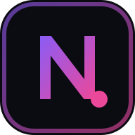

<p align="center"></p>

# NullxAnime

A sleek, fast **anime + manga** hub. No captcha, no ads, no account, no tracking — it's a static site (plain ES modules, **no build step**) that runs on GitHub Pages.

**Live:** https://inkflow-gab.github.io/NullxAnime/ (after the first deploy — see [Deploy](#deploy))

## Features

| Area | What you get |
| --- | --- |
| **Anime** | Hero carousel, a **Top 10 ranking** right under it (trending / most popular / top rated / this season), **Recently updated** (episodes that just aired, linking straight to the episode), **New releases**, **Airing soon** and **Upcoming anime with premiere dates**, plus airing / seasonal / top-rated rails, full search + filters (genre, format, status, season, year, sort), detail pages with episodes, characters, relations, recommendations, tags, staff. Data: [AniList](https://anilist.co). |
| **Watch** | Official free YouTube streams + trailers play inline; per-episode links to the official service (Crunchyroll, Netflix, Muse Asia…); public-domain / CC video from the [Internet Archive](https://archive.org); "My link / file" player for your own media (MP4, WebM, HLS, YouTube, local files, SRT/VTT subtitles). Custom player with keyboard shortcuts, speed, quality, PiP, resume position. An optional AnimeGG worker and AniPub source player are available on the watch page. |
| **Manga** | Home rails (popular, latest, top rated, manhwa, manhua), search + tag/origin/demographic filters, chapter lists in 18 languages, and a full reader (vertical webtoon, paged LTR/RTL, fit modes, data saver, keyboard/tap zones, auto prefetch). Data: [MangaDex](https://mangadex.org). Only *safe/suggestive* ratings. |
| **Tracker** | One list for anime + manga: status, progress, score, history, stats, JSON backup/restore, MyAnimeList/AniList XML export. Lives in `localStorage`. |
| **Schedule** | Per-day airing calendar in your timezone, "only my list" filter. |
| **Discover** | Curated directory of trackers, schedules, official sources and tools (derived from [awesome-anime-sources](https://github.com/anshumanv/awesome-anime-sources), legal sources only). |
| **Polish** | Command-palette search (`/` or `Ctrl+K`), dark / OLED / light themes, 6 accents, installable PWA + offline shell, mobile tab bar, keyboard shortcuts (`?`), optional TV mode with arrow-key navigation. |

## Community streaming

The watch page starts with **Instant play**, a direct episode embed using the same fallback endpoint as Kitsune. No server URL is required, but the provider may be unavailable, block embedding or lack a particular episode. The AnimeGG tab uses provider logic adapted from [Kitsune](https://github.com/Dovakiin0/Kitsune): search for a series, select the exact season and audio, and play its episode through a small **NullxAnime streaming worker**. GitHub Pages only hosts the frontend: the worker must be deployed separately over HTTPS before this tab works. It is not connected to Kitsune's hosted site.

The AniPub tab searches [AniPub](https://github.com/AnimePub/AniPub)'s catalogue and extracts the video or iframe source from its episode page, rather than embedding the entire page. AniPub's episode links are stored in its MongoDB database, not in its repository; this tab still needs access to an AniPub deployment. CORS or source-host restrictions may prevent playback.

Both integrations depend on third-party services and were not tested against live providers in this environment. See [docs/PROVIDERS.md](docs/PROVIDERS.md) for deployment, licensing, and limitations.

## Run locally

```bash
npm install        # only needed for tests
npm start          # → http://localhost:8080  (any static server works)
npm test           # headless-Chrome end-to-end tests with mocked APIs
```

## Deploy

GitHub Pages is deployed by [`.github/workflows/pages.yml`](.github/workflows/pages.yml) on every push to `main`.
One-time setup: **Settings → Pages → Build and deployment → Source: GitHub Actions**.

## Project layout

```
index.html            app shell
css/                  base (tokens, shell) · components · pages
js/main.js            bootstrap, shortcuts, PWA
js/router.js          hash router (lazy page modules)
js/store.js           settings, library, history, backups (localStorage)
js/api/               anilist · mangadex · archive clients
js/sources.js         official watch sources (YouTube, official links, search links)
js/player.js          custom video player (MP4/WebM/HLS)
js/pages/             one module per route
js/ui/                icons, cards/rails/toasts/popovers, search palette
tests/                static server, API mocks, e2e
```

## Credits

[Cinzel](https://github.com/google/fonts/tree/main/ofl/cinzel) (SIL Open Font License 1.1; see `assets/fonts/OFL-Cinzel.txt`); AniList, MangaDex and the Internet Archive for their open APIs; [hls.js](https://github.com/video-dev/hls.js) (Apache-2.0, vendored in `vendor/`). All anime, manga and artwork belong to their owners — please support official releases.
